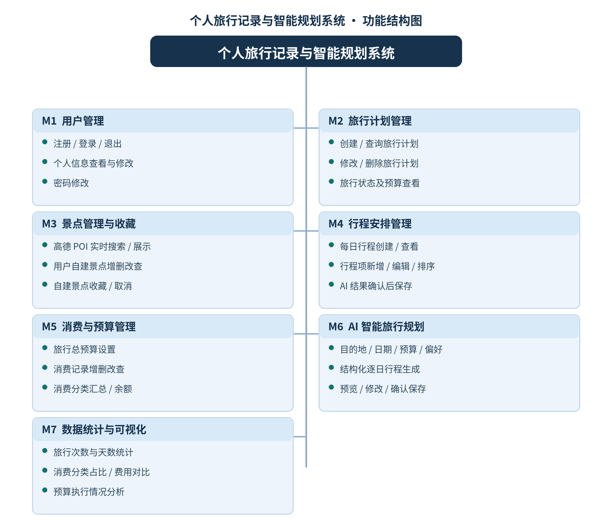

# 个人旅行记录与智能规划系统——需求分析说明书（最终版 V1.0）

**项目**：数据库原理与应用课程设计  |  **截止**：2026-11-30  |  **两人协作**

> 技术：Vue 3 + Spring Boot + MyBatis + MySQL + ECharts + AI 大模型 API + 高德 POI 2.0 实时搜索。

## 一、建设目标

实现账号、旅行计划、用户自建景点与收藏、每日行程、消费预算、AI 智能规划及图表统计。第三方高德 POI 数据仅用于实时查询展示，不直接持久化、批量抓取或缓存（见官方协议第 3.5 条）。

## 二、功能结构图

## 三、功能性需求明细

### 4.1 M1 用户管理

| ID | 功能 | 操作与结果 | 优先级 |
|---|---|---|---|
| FR-01 | 注册账号 | 用户名、密码、确认密码；用户名唯一、密码哈希存储。 | P0 |
| FR-02 | 登录与退出 | 账号密码校验；登录后只允许访问本人数据；退出使登录状态失效。 | P0 |
| FR-03 | 查看/修改个人信息 | 查看用户名、昵称等个人资料；修改可编辑字段。 | P1 |
| FR-04 | 修改密码 | 验证旧密码、检查新密码规则后更新哈希。 | P1 |

### 4.2 M2 旅行计划管理

| ID | 功能 | 操作与结果 | 优先级 |
|---|---|---|---|
| FR-05 | 创建旅行计划 | 填写名称、目的地、出发/结束日期、总预算。 | P0 |
| FR-06 | 查看旅行列表/详情 | 仅查询当前用户的旅行；展示时间、预算、状态、每日安排摘要。 | P0 |
| FR-07 | 修改旅行计划 | 可修改名称、目的地、日期、预算；时间变化需校验已有行程项。 | P0 |
| FR-08 | 删除旅行计划 | 二次确认；以事务删除或级联处理相关天数、行程和消费等关联记录。 | P0 |
| FR-09 | 计算旅行状态 | 以系统当前日期与旅行开始/结束日期推导未开始、进行中、已结束。 | P1 |

### 4.3 M3 景点管理与收藏

| ID | 功能 | 操作与结果 | 优先级 |
|---|---|---|---|
| FR-10 | 高德 POI 实时搜索 | 城市/区域 + 关键词 + 分页检索；展示名称、地址、分类及可用地理信息。 | P0 |
| FR-11 | 结果临时查看 | 结果由后端透传必要展示字段；不自动入库、不批量缓存、不建立镜像库。 | P0 |
| FR-12 | 自建景点 CRUD | 用户独立填写景点名称、城市、描述及建议时长，可修改/删除。 | P0 |
| FR-13 | 收藏/取消收藏 | 对用户自建的本地景点创建/删除收藏关系；禁止重复收藏。 | P0 |
| FR-14 | 收藏列表与查询 | 查询个人收藏的本地景点，可按名称或城市筛选。 | P0 |

### 4.4 M4 行程安排管理

| ID | 功能 | 操作与结果 | 优先级 |
|---|---|---|---|
| FR-15 | 每日行程展示 | 按旅行起止日期分组显示每日活动，支持空日期。 | P0 |
| FR-16 | 手动新增行程项 | 添加自建景点或用户自填活动；输入日期、时段、顺序和备注。 | P0 |
| FR-17 | 修改/删除行程项 | 变更时间、活动、排序、备注，或删除指定活动。 | P0 |
| FR-18 | 行程顺序调整 | 按 sort_order 维护同一天活动顺序，避免重排后顺序冲突。 | P1 |
| FR-19 | 导入已确认 AI 方案 | 将用户审核后的结构化结果保存为 trip_day 和 itinerary_item；使用数据库事务。 | P0 |

### 4.5 M5 消费与预算管理

| ID | 功能 | 操作与结果 | 优先级 |
|---|---|---|---|
| FR-20 | 预算设置与修改 | 预算存于 trip；数值不得为负。 | P0 |
| FR-21 | 消费记录 CRUD | 填写金额、分类、日期、说明；只管理本人旅行下的记录。 | P0 |
| FR-22 | 分类统计与余额 | 按旅行聚合 SUM 金额；余额=预算-实际消费。 | P0 |
| FR-23 | 区分预计与实际 | AI 预估费用仅作规划建议；不得自动写成 expense 真实消费。 | P0 |

### 4.6 M6 AI 智能旅行规划

| ID | 功能 | 操作与结果 | 优先级 |
|---|---|---|---|
| FR-24 | 输入规划条件 | 目的地、出行日期/天数、总预算、交通方式、偏好、补充要求。 | P0 |
| FR-25 | 生成结构化行程 | 调用模型生成 JSON 结构，包含每天的活动名称、时间、说明、预计费用。 | P0 |
| FR-26 | 响应校验与错误反馈 | 验证日期范围、列表长度、必要字段和金额合法性；异常时展示可理解错误。 | P0 |
| FR-27 | 结果预览与编辑 | 按天预览；修改时间、活动、顺序和备注；不直接覆盖现有正式行程。 | P0 |
| FR-28 | 确认保存到 MySQL | 生成时记录 AI 草稿；确认后事务性写入正式行程并更新 AI 记录保存状态。 | P0 |
| FR-29 | 生成历史查询 | 查询本人历史 AI 方案、输入条件和保存状态。 | P1 |
| FR-30 | AI 预估费用 | 展示 AI 估算费用总额及说明，标记非真实价格。 | P1 |

### 4.7 M7 数据统计与可视化

| ID | 功能 | 操作与结果 | 优先级 |
|---|---|---|---|
| FR-31 | 旅行次数与天数 | 统计用户全部旅行数和累计天数，跨表关联去重。 | P0 |
| FR-32 | 消费分类占比 | 按消费类别聚合，生成 ECharts 饼图。 | P0 |
| FR-33 | 不同旅行费用对比 | 按旅行聚合实际消费，生成柱状图。 | P0 |
| FR-34 | 预算执行分析 | 对比旅行预算、实际消费和剩余预算。 | P0 |

## 四、数据需求（8 张核心表）

| 表名 | 数据来源 | 说明 |
|---|---|---|
| user | 用户注册 | 密码哈希、用户名唯一 |
| trip | 用户创建 | 旅行名称/日期/预算 |
| attraction | 用户独立填写 | 不是高德 POI 数据拷贝 |
| favorite | 用户操作 | 仅收藏本地自建景点 |
| trip_day | 旅行安排/AI 正式保存 | 每趟旅行每天唯一 |
| itinerary_item | 用户操作/AI 正式保存 | 活动时间、名称、顺序 |
| expense | 用户实际消费 | 不把 AI 预算当实际消费 |
| ai_plan_record | 用户输入与大模型生成 | JSON、状态、时间 |

## 五、API 设计与边界

- 高德官方地址：`GET https://restapi.amap.com/v5/place/text`；关键参数 `key`、`keywords`、`region`、`city_limit`、`page_size`（1-25）、`page_num`。
- 由 Spring Boot 后端代理请求，前端只调用 `/api/pois/search`；检查 `status=1`、`infocode=10000`，对无效 Key、超限与网络错误给出提示。
- 严格遵守官方服务协议：不直接把高德返回的 POI ID、地址、坐标、照片等写入数据库。用户需独立手填景点或活动内容才能作为自己的数据保存；未经授权，不提供一键保存第三方 POI 原始数据。
- 其余后端接口：用户认证 `/api/auth/*`，旅行 `/api/trips`，自建景点 `/api/attractions`，收藏 `/api/favorites`，行程 `/api/itinerary-items`，消费 `/api/expenses`，AI `/api/ai/plans`，统计 `/api/statistics/*`。

## 六、主要业务流程

**用户旅行**：注册登录 → 创建旅行 → 按天管理行程 → 填消费 → 统计。

**景点查询**：输入城市/关键词 → Spring Boot 查询高德 → 临时结果显示 → 自建景点（用户独立输入） → 收藏。

**AI 规划**：输入条件 → 大模型生成结构化 JSON → 校验并存 AI 草稿 → 预览编辑 → 用户确认 → 事务写入 `trip_day`、`itinerary_item`，同时更新 `ai_plan_record` 状态。

## 七、非功能性要求

- 身份认证及本人数据隔离，密码哈希，密钥服务器端管理，接口敏感信息不记日志。
- 主外键、唯一约束、金额/日期校验；跨表写入使用事务；统计由真实 MySQL 聚合数据生成。
- 第三方调用超时、报错、限流不破坏已存旅行记录；页面有加载和错误提示。

## 八、验收与开发计划

- 验收：登录、旅行/自建景点/收藏/行程/费用 CRUD、POI 实时搜索、AI 生成保存、聚合图表、用户隔离、主外键约束与事务回滚。
- 11/17–19：需求、E-R、表结构；11/20–24：CRUD；11/25–26：POI 与 AI；11/27–28：联调测试；11/29–30：报告与答辩。

## 九、引用

- [1] 高德地图开放平台，《搜索 POI 2.0 / Web 服务 API》：https://lbs.amap.com/api/webservice/guide/api-advanced/newpoisearch
- [2] 高德地图开放平台，《高德地图开放平台服务协议》：https://developer.amap.com/pages/terms/
- [3] 高德地图开放平台，《服务升级 / 配额说明》：https://developer.amap.com/upgrade
- [4] 高德地图开放平台，《错误码说明》：https://lbs.amap.com/api/webservice/guide/tools/info
- [5] 高德地图开放平台，《个人研究学习用途与许可常见问题》：https://lbs.amap.com/faq/advisory/authorization/43168
- [6] LeeFly-cn，《TripStar-Java 开源项目》：https://github.com/LeeFly-cn/TripStar-Java
- [7] LeeFly-cn，《TripStar-Frontend 开源项目》：https://github.com/LeeFly-cn/TripStar-Frontend
